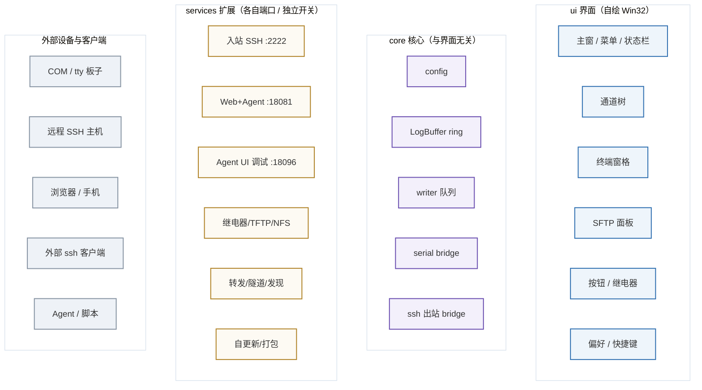
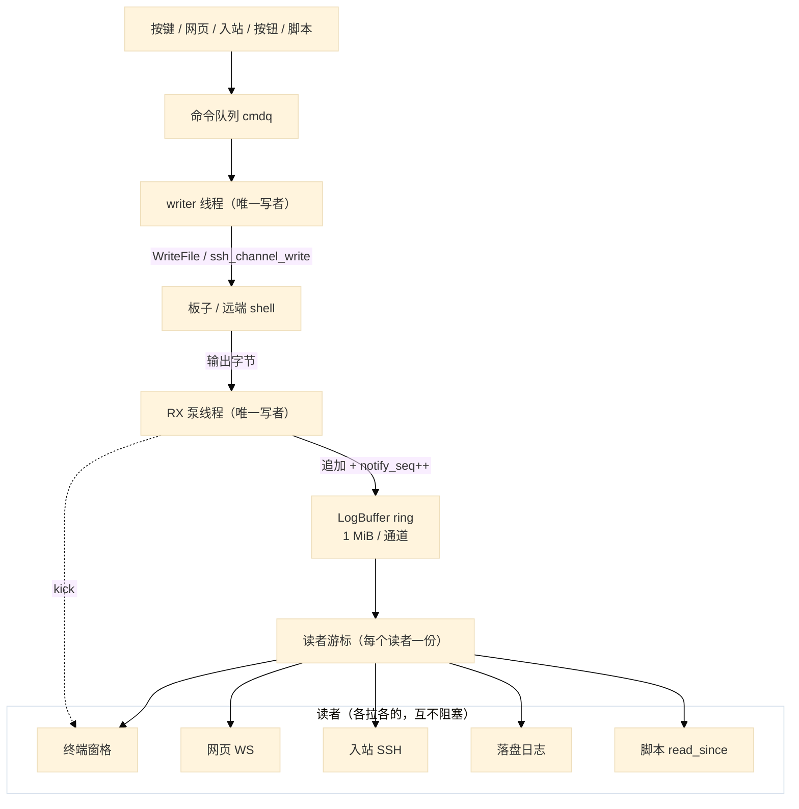
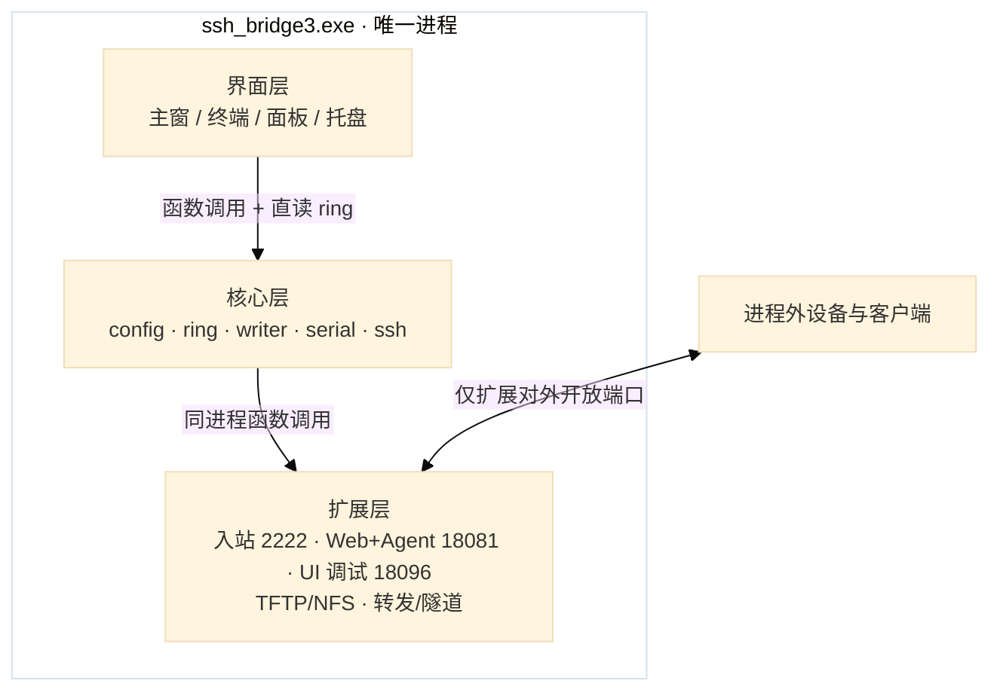

# 架构总览（SSH Bridge 3）

> 本文是总图，回答“它长什么样、数据怎么流、边界在哪”。
> 逐步骤的实现细节见 `docs\详细设计.md`；逐步增加的模块用颜色阶梯图看 `docs\阶梯架构图.md`。

## 0. 一句话形态

`ssh_bridge3.exe` 是一个**原生 Win32 的完整终端工具**：串口 / SSH 出站 / 环形日志 / 终端渲染 / SFTP / 按钮 / 托盘，全部跑在**同一个进程、同一份内存**里；入站 SSH、网页、Agent、TFTP/NFS、转发/隧道，都是挂在这个工具上的**扩展**，各自可开关。

硬规则（违反即返工）：

1. 界面**直读内存**，不走本地 HTTP、不占端口；端口只对进程外开放。
2. 一路通道**一个 ring**，**只有 RX 泵线程写**；TX 走独立写队列。
3. 扩展**只准加、不准改本体接口**；要改先改设计。
4. 每步清单全量 PASS 才进下一步（见 `docs\每步测试闸门.md`）。
5. **18081 是 Agent 控板的唯一主路径；18096 只做桌面 UI 调试/兜底，不参与板控闭环，18081 禁止反向调用 18096。**

## 1. 整体分层（四层条带）

一个色块 = 一个模块，四列由外向内依次是 **外部设备 / 扩展 / 核心 / 界面**。这是 `desktop.exe` 内部的静态结构，不含时序。



要点：**界面层与核心层之间是函数调用与同一块内存**，不存在序列化；扩展层是唯一对外开口的地方。

## 2. 一条通道的数据面（RX 单写多读 + TX 多写一读）



三条不变式：

| 不变式 | 含义 | 违反的后果 |
|---|---|---|
| ring 只有 RX 泵线程写 | 下行字节永不进 ring | 自己敲的命令被当设备输出回显、日志失真 |
| 读者只带游标、不持锁 | 慢读者只丢自己的数据，不堵写者/别人 | 一个网页卡住拖死整条通道 |
| 时间戳只在上行写 ring 前打一次 | 所有读者拿到同一份加工结果 | 桌面与网页内容不一致 |

配套规则：

- **绝对偏移游标**：`total` 单调递增，读者用自己的 `abs` 换算下标；落后超过容量就当“已丢弃 N 字节”，从最老处继续。
- **清屏只动 base**：`clear()` 只把最老位置推到写头，不重置别人的游标。
- **CR-hold**：块尾若是裸 `CR`，先暂存，等下一个字节判断 CRLF / 重写，避免网页卡住半行。
- **无本地回显**：回显来自板端真实 RX 字节，界面不画。

## 3. 进程边界



> 界面层与核心层之间是**函数调用 + 同一块内存**：0 端口、0 IPC、0 JSON、0 第二个进程。唯一对外的开口在扩展层，对端是 COM 设备、远程主机、浏览器、外部 ssh 客户端与 Agent 脚本。

端口只有这几个，且都属于扩展：

| 端口 | 用途 | 归属步骤 |
|---|---|---|
| 18081 | HTTP + WS 网页 + **Agent 设备控制 API** | S9 / S10 |
| 2222 | 共享入站 SSH（用户名=通道名） | S8 |
| 18096 | Agent 桌面 UI 调试桥（仅 127.0.0.1） | S10 |
| 69/udp | TFTP | S11 |
| 18071/udp | 局域网发现应答 | S12 |
| 18087 | 隧道管理口（frpc 子进程） | S12 |
| 22000+ | 板网 TCP 转发（基数 + 末字节） | S12 |

## 3.1 Agent 的两套系统（不可混用）

```text
Agent / CLI ── 18081 设备控制面 ── ChannelCore ── 串口 / SSH / 继电器 / TFTP
调试器 / 回归 ── 18096 桌面 UI 桥 ── bridge_host ── Win32 控件 / 对话框
```

| 维度 | 18081 设备控制面 | 18096 桌面 UI 桥 |
|---|---|---|
| 目的 | 完整控制板子 | 控制桌面窗口，供调试/回归/人工兜底 |
| 典型接口 | `/status` `/agent/scan` `/agent/probe` `/command` `/agent/exec` `/lock` `/jobs` `/tftp/*` | `/capabilities` `/ui-tree` `/control` `/state` `/action` `/logs` |
| 数据真值 | `ChannelCore`、`LogBuffer`、服务状态 | 控件树、控件态、UI 快照 |
| 板控能力 | **必须完整、独立成立** | 不承担。点击板控按钮也只算 UI 动作 |
| 关闭影响 | 关闭后 Agent 无法控板；Web 只读仍可用（取决于 Web 开关） | 关闭后不影响 18081 任何板控能力 |
| 依赖 | 只依赖 core/service，**禁止依赖 18096** | 只依赖 UI 线程，不依赖 18081 的板控路由 |

硬规则：

1. 18096 关闭时，18081 的扫描、探测、执行、锁、作业、文件传输必须全部通过。
2. 18081 关闭时，18096 的控件树和桌面动作仍可独立工作。
3. 18081 的代码路径不得出现 18096 调用、18096 URL、`/ui-tree`、`/control`、`X-Ui-Token`；仅允许状态字段和边界文案提及 18096，不得携带任何可调用入口或代理。
4. 任何“板控能力缺失”都补在 18081，不得用 18096 点按钮绕过。
5. 人用的 Web 页面和 Agent 共用 18081 的板控 API；页面只是同一能力的 UI，不是第二套业务逻辑。

## 4. 两层与 14 步的映射

| 层 | 步骤 | 这一步让工具多出什么 |
|---|---|---|
| 地基 | S0 | 目录、构建、接口契约、测试闸门 |
| 本体 | S1 | 配置 + ring + 串口桥（`--selftest` 可独立验证） |
| 本体 | S2 | SSH 出站链路（与串口同构） |
| 本体 | S3 | 窗口壳 + 托盘 + 单实例（X 只隐藏） |
| 本体 | S4 | 终端窗格（直读 ring、ANSI、回看、分屏） |
| 本体 | S5 | 通道管理 + 手术式热应用 + 自动发现 |
| 本体 | S6 | 偏好 / 主题 / 快捷键 / 会话操作 / 自动跟随 |
| 本体 | S7 | SFTP、xmodem、按钮、Lua（**本体出口，可独立交付、零端口**） |
| 扩展 | S8 | 共享入站 SSH |
| 扩展 | S9 | HTTP 基元 + 网页端 |
| 扩展 | S10 | Agent 双面：18081 完整板控 API；18096 桌面 UI 调试桥 |
| 扩展 | S11 | 继电器 / TFTP / NFS / 共享目录 |
| 扩展 | S12 | TCP 转发 / 隧道 / UDP 发现 |
| 扩展 | S13 | 自更新 / 打包 / 全量回归 |

## 5. 文档地图

| 文档 | 作用 |
|---|---|
| `README.md` | 入口：构建、目录、当前状态 |
| `docs\架构总览.md` | 本文：整体框图、数据面、边界、端口 |
| `docs\详细设计.md` | 逐步骤：模块 / 文件 / 接口 / 数据流 / 验收 / v2 参照 |
| `docs\阶梯架构图.md` | 14 张颜色阶梯图，看“每步新增了什么” |
| `docs\功能清单.md` | 141 条功能面，带来源与归属步骤 |
| `docs\AGENT-CAPABILITY-PLAN.md` | Agent 能力模型、参考实现、P0/P1/P2 规划 |
| `docs\AGENT-EXECUTION-LIST.md` | Agent 能力逐批执行表、文件、测试、提交批次 |
| `docs\每步测试闸门.md` | 出口条件（清单 / 全量 PASS / 代码整理） |
| `docs\编程规范.md` | 提交粒度、提交信息、warning 清零 |
| `docs\执行记录.md` | 过程、踩坑、决策、提交链，供新会话接手 |
