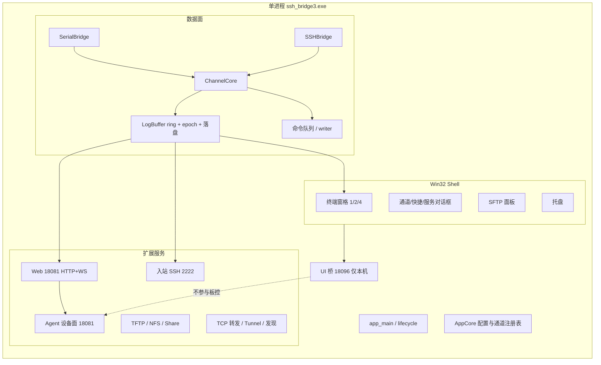

# 设计初衷与实现对照（2026-11-23 审计）

**审计对象**：`C:\code\ssh-bridge-windows3`，分支 `feature/web-console-complete-20261123`。  
**设计基线**：`docs/功能清单.md`（141 条）、`C:\code\ssh-bridge` 的 `DESIGN.md` / `docs/设计文档.md` / `需求列表.md` / `webui_static`。  
**方法**：先写回每条功能“为什么存在、用户怎么用、验收看什么”，再按源码与接口逐项对照；发现偏离设计、重复实现、边界失守、并发/一致性问题，直接修复并补回归。  
**结论**：141 条中 **126 条完整实现、3 条部分实现、12 条未实现**；本轮共修复 14 类真实缺陷，网页终端改为 xterm 5.3 一体框并完成桌面/移动端 20 项验收。本轮复核又把配置指针/通道表并发、`/api/channels` 局部写丢字段、Agent 帮助泄露配置面收口。

---

## 1. 产品初衷：一个原生终端工具，扩展挂在它身上

这款工具的第一身份不是“管理后台”，而是 **Windows 原生终端工具**：串口和 SSH 通道、终端渲染、SFTP、按钮、托盘都在同一个进程里，界面直读内存，不另建设备连接。入站 SSH、网页、Agent、TFTP/NFS、转发/隧道是可选扩展，每项可独立开关，关掉不影响本体。

由此推出四条不可违背的产品原则：

1. **终端优先**：会话区是主视觉，任何导航、工具栏、状态卡都不能挤占终端；网页端与桌面端同权。
2. **输入输出同框**：网页端不是“上面回显、下面另开输入框”的表单，而是同一个深色会话框，底部输入，特殊键在框内。
3. **一条通道一份数据**：串口/SSH、桌面、网页、入站 SSH、Agent 共享同一份 ring / 命令队列 / 锁，不复制连接、不二次加工。
4. **扩展不反客为主**：18096 只做本机 UI 调试；Tunnel 不进 Agent 帮助；关掉扩展，本体仍是完整终端。

---

## 2. 当前结构（以源码为准）

**关键边界**

- 18081 是唯一设备控制面；18096 只服务桌面窗口调试，18081 不调用、不代理 18096。
- Web 与 Agent 共用 18081 端口和 token；读接口公开，写接口 Bearer token。
- 入站 SSH 只挂到既有出站通道，不新建 target SSH；用户名=通道名。
- Tunnel 与 `/service` 仍可供人工/管理接口使用，但不进入 Agent 的 `operations` 发现面。

---

## 3. 网页终端：按旧版 `webui_static` 的体验重建

### 3.1 旧版为什么那样做

旧版 `C:\code\ssh-bridge\webui_static\dashboard.html` 使用 **xterm 5.3.0 + FitAddon**，`convertEol:false`，支持 Ctrl+C/Z/D/L、方向键、Ctrl+Shift+C/V、全屏、字号、查找、复制、下载。它不是“把日志贴在 `<pre>` 里”，而是真正的终端模拟器——因为 ncurses/nmtui/vi 这类全屏程序依赖原始 CR/LF、光标定位和颜色，纯文本 `<pre>` 做不到。

### 3.2 v3 本轮实现

`src/services/web/web_pages.cpp` 的仪表盘已改为：

- **xterm 5.3.0 + FitAddon 0.8.0**，CDN 加载；失败自动回退到净化后的 `<pre>`，离线仍可用。
- 回显区就是输入区：没有独立输入框，字符直接落在 xterm 当前光标处；桌面键条隐藏，移动端键条只作辅助。
- 通道面板默认折叠（`sb3_dash_nav_collapsed` 持久化），首屏把宽度留给终端。
- 16 个特殊键：Esc / Tab / Ctrl+C / Ctrl+D / Ctrl+Z / Ctrl+L / Ctrl+U / Ctrl+R / ↑ / ↓ / ← / → / Home / End / PgUp / PgDn，全部走 `/write`；桌面不显示键条，移动端显示。
- 原位输入：普通字符每键进入 8ms 有序合批后立即 `/write`；Enter 按通道 `kind` + `line_ending`（SSH 默认单 CR、串口按 cr/lf/crlf/none），不再固定 `\r`。
- 点会话区即聚焦 xterm 隐藏 textarea；页面加载 120ms 自动聚焦、切通道 80ms 再聚焦；移动端点击后才弹软键盘。
- Ctrl+Shift+C 复制、Ctrl+Shift+V 粘贴；有选区时 Ctrl+C 保留浏览器复制。
- 查找：xterm 模式下遍历 buffer，命中后 `select + scrollToLine`；回退模式高亮 `<mark>`。
- 字号、全屏、下载日志、清空缓冲、Agent 锁提示与人工接管全部保留。
- xterm 主题与页面深色终端框一致；`convertEol:false` 对齐 ncurses。

### 3.3 本轮修掉的两个前端缺陷

| 缺陷 | 现象 | 根因 | 修复 |
|---|---|---|---|
| 折叠通道后终端只有 2px 宽 | 会话区塌成竖条，键条溢出到框外 | `channel-card` 设 `display:none` 后，`terminal-card` 被网格自动放进第 1 列（0 宽） | `.dash .terminal-card{grid-column:2}` 固定在第 2 列 |
| `isOnline is not defined` | 仪表盘初始化中断，通道列表/在线数/“可写”状态不更新，控制台反复报错 | 公共 JS 只有 `fmtBytes`，没有 `isOnline` | 在 `kCommonJs` 补 `isOnline()`，兼容 ready/online/connected |

另外把 FitAddon 首次 fit 从“一次 RAF”改为同步 fit + 16ms 合并重算 + 60/350/900ms 多次 fit + resize/visibilitychange 监听 + ResizeObserver；移动端首次字号上限 12px，折叠/全屏/回到前台后都会重算行列。

### 3.4 实测尺寸

| 视口 | 终端列×行 | 会话框 | 输入位置 | 结果 |
|---|---|---|---|---|
| 1440×960 | 176×41 | 1394×657.5 | xterm 原位输入，无独立条 | 通过 |
| 390×844 | 42×38 | 364×629.1 | xterm 原位输入，键条辅助 | 通过 |

验收脚本：`output/webtest/web-terminal-xterm-check.js`，结果 `output/ux-audit/web-terminal-xterm-check.json`，**20/20 通过，0 JS 错误**。截图：`web-terminal-xterm-desktop.png`、`web-terminal-xterm-mobile.png`。

---

## 4. 逐项功能初衷与实现状态

图例：✅ 完整实现；◐ 部分实现；✗ 未实现。  
“证据”只写承载位置或关键行为，详细测试见文末。

### A 通道与连接（本体，10）

| # | 设计初衷 | 状态 | 实现/证据 |
|---|---|---|---|
| A1 | 串口是本体入口，参数可配 | ✅ | `serial_bridge.cpp` 打开 COM/tty，波特率/数据位/校验/停止位/流控/DTR/RTS |
| A2 | 低延迟读，不能轮询卡 UI | ✅ | Windows overlapped + `WaitCommEvent`；Linux raw/poll |
| A3 | 所有下行只入队，调用线程不碰 `WriteFile` | ✅ | `cmd_queue` + writer 线程 |
| A4 | SSH 出站：PTY + shell + 密码 | ✅ | `ssh_session.cpp`、`ssh_bridge.cpp` |
| A5 | 断线只影响本通道，指数退避重连 | ✅ | `ssh_bridge` 重连状态与 attempts |
| A6 | 串口/SSH 同构，共用 ring/队列/fan-out | ✅ | 两者都落 `ChannelCore` |
| A7 | 时间戳只给设备输出，下行不加 | ✅ | `LogBuffer::append` 上行路径 |
| A8 | 行尾与编码可配 | ✅ | `apply_line_ending`；串口 GBK 转换 |
| A9 | 启动自动打开 | ✅ | `AppCore::start_auto` 读 `auto_open` |
| A10 | 列出本机串口及描述 | ◐ | 桌面通道/继电器对话框用 `QueryDosDeviceW` 枚举；无 Web/Agent `/serial/ports` 接口 |

### B 终端显示与交互（本体，12）

| # | 设计初衷 | 状态 | 实现/证据 |
|---|---|---|---|
| B1 | ANSI 颜色、光标、清屏、CR 覆盖、制表位 | ✅ | `ui/terminal/ansi.*`、`view.cpp` |
| B2 | 直读 ring，不建 socket | ✅ | `notify_seq` 变化才取增量 |
| B3 | 可滚动回看，行数可配 | ✅ | `scrollback_lines`（默认 6000） |
| B4 | 回看内查找定位 | ✅ | 桌面搜索框 + 网页查找 |
| B5 | 选中复制、右键粘贴、大段不丢 | ✅ | 终端选区 + 粘贴路径 |
| B6 | 1/2/4 分屏，每格独立游标 | ✅ | `pane.cpp`、`ui.split`、`ui.active_pane`、`pane_channels` |
| B7 | 隐藏窗格不耗 CPU | ✅ | 不可见窗格跳过读取 |
| B8 | 键盘映射正确字节 | ✅ | `input.cpp`；`T4U-11/12` |
| B9 | Ctrl+C/Z、Esc、Tab | ✅ | 桌面与网页键条一致 |
| B10 | Ctrl+滚轮/菜单字号即时生效 | ✅ | `font_size`、网页 `term-font` |
| B11 | UTF-8 中文/表情不乱码 | ✅ | 宽字符与 BMP 外字符处理 |
| B12 | 右键加载完整历史 | ✅ | `term.reload`、`read_all` 重放 |

### C 通道与会话管理（本体，9）

| # | 设计初衷 | 状态 | 实现/证据 |
|---|---|---|---|
| C1 | 新建通道：串口/SSH 二选一，表单联动 | ✅ | 桌面 `channel_dialog`、Web `/channels` |
| C2 | 改参数即时生效，不重启进程 | ✅ | `apply_config` 热应用 |
| C3 | 删除通道并释放串口 | ✅ | 注册表摘除 + `stop()` |
| C4 | 手术式热应用，只重建受影响通道 | ✅ | added/removed/changed/kept |
| C5 | 同名覆盖、异名新增 | ✅ | upsert |
| C6 | 新串口出现时弹“新增板卡”并预选 | ✗ | 无 `WM_DEVICECHANGE`、无端口差分；`auto_discover_serial` 导出硬编码 true，无字段无行为 |
| C7 | 重连/断开/清屏/日志开关/落盘目录 | ✅ | 桌面菜单 + Web/Agent 通道接口 |
| C8 | 会话内改波特率，无需删建 | ✅ | `serial.configure` |
| C9 | 空闲时跟随有输出通道，15s 冷却 | ✗ | 源码无 `auto_follow` |

### D 文件与传输（本体，8）

| # | 设计初衷 | 状态 | 实现/证据 |
|---|---|---|---|
| D1 | SFTP 双栏本地/远端 | ✅ | `ui/sftp/sftp_window.cpp` |
| D2 | 上传/下载进度、取消、覆盖确认 | ✅ | SFTP 面板 |
| D3 | 大文件后台线程，不卡终端 | ✅ | 传输线程与 UI 分离 |
| D4 | XMODEM/YMODEM 走同一串口 | ✗ | 无 `xmodem/ymodem` 源码 |
| D5 | 会话右键“上传到板目录” | ✗ | 有通用 SFTP，无会话右键快捷入口 |
| D6 | 会话右键“上传到 common” | ✗ | 同上 |
| D7 | 日志下载，默认去控制符，`raw=1` 原样 | ✅ | `/log/download` |
| D8 | 传输后 MD5，不一致可重传 | ✅ | `/tftp/md5` 与 SFTP 校验 |

### E 按钮与脚本（本体，9）

| # | 设计初衷 | 状态 | 实现/证据 |
|---|---|---|---|
| E1 | 通道 `buttons[]`，主页只显示 enable | ✅ | `board_action_runner`、Web 板控页 |
| E2 | 固定按钮 id：power_on/off/reboot/upgrade | ✅ | 动作白名单 |
| E3 | commands 型带 `delay_ms` | ✅ | 动作运行器 |
| E4 | 同 id 不能两个 backend 同时 enable，冲突 409 | ✅ | 动作保存校验 |
| E5 | `send_keys` 支持 `<ctrl+c>` 与字面字节 | ✅ | `key_chars.cpp` |
| E6 | `duration <= interval` 只走一遍 | ✅ | 动作运行器 |
| E7 | Lua 脚本可 if/while、读 log 分支 | ✅ | `script_lua.cpp`（Lua 5.4） |
| E8 | channel.write/send/keys/read_since/wait_mark/wait_idle/mark、relay()、action() | ✅ | Lua API 绑定 |
| E9 | 底部快捷指令条，按画框独立，自动换行 | ✅ | `quick_dialog`、Web 快捷/脚本页 |

### F 界面与个性化（本体，7）

| # | 设计初衷 | 状态 | 实现/证据 |
|---|---|---|---|
| F1 | 多套主题，单一取色源 | ✗ | 无主题模块/取色源 |
| F2 | 字号/缩放持久化 | ✅ | `ui_prefs.ini` / 配置 `font_size` |
| F3 | 快捷键可绑定、冲突检测、说明页 | ✗ | 无 hotkey 模块 |
| F4 | 独立窗口打开某通道 | ✗ | 无多窗口创建 |
| F5 | 文件/视图/工具/帮助菜单 | ✅ | `shell.cpp` 菜单 |
| F6 | 状态栏：连接、波特率、缓冲、行列 | ✅ | 状态栏绘制 |
| F7 | 侧栏通道树与在线灯 | ✅ | 通道树 |

### G 日志与诊断（本体，6）

| # | 设计初衷 | 状态 | 实现/证据 |
|---|---|---|---|
| G1 | 1MiB 环形缓冲，可配 256K/1M/4M | ✅ | `LogBuffer` |
| G2 | 按通道落盘，`log_enabled` + `log_dir` | ✅ | `LogBuffer` 盘写 |
| G3 | 落盘与 ring 同一加工结果 | ✅ | 修复后 `import_history` 不再二次加工 |
| G4 | 清屏/清日志只影响本地或本通道 | ✅ | 本地游标 + `/log/clear` epoch |
| G5 | 崩溃日志 `work/logs/crash.txt` | ✗ | 无 `SetUnhandledExceptionFilter`/MiniDump |
| G6 | 关于框/状态栏显示版本与构建时间 | ✅ | `kVersion`、`kBuild` |

### H 生命周期与部署（本体，7）

| # | 设计初衷 | 状态 | 实现/证据 |
|---|---|---|---|
| H1 | 单进程，界面+桥+服务同进程 | ✅ | `app_main` |
| H2 | 关闭到托盘，服务继续 | ✅ | `ui.close_to_tray` 可配；false 时真正退出 |
| H3 | 托盘菜单：显示/网页/服务/退出 | ✅ | `tray.cpp` |
| H4 | 托盘退出才停服务，逆序释放 | ✅ | `WM_DESTROY` → `stop_all` |
| H5 | 单实例，第二实例唤醒已有窗口 | ✅ | `CreateMutex` |
| H6 | 开机自启，可开关 | ✗ | 无注册表 Run 项 |
| H7 | 退出码 0、无残留进程、端口全释放 | ✅ | 闸门 G-3/G-4 |

### I 入站 SSH（扩展，6）

| # | 设计初衷 | 状态 | 实现/证据 |
|---|---|---|---|
| I1 | 唯一 `ssh_bind`，默认 :2222，用户名=通道名 | ✅ | `inbound_gateway.cpp` |
| I2 | 密码三级继承：通道→default→none | ✅ | 入站认证 |
| I3 | 对端 RX 广播所有入站会话，慢连接只丢自己 | ✅ | fan-out 队列 |
| I4 | `inbound.enable=false` 不 bind，不回退每板端口 | ✅ | 生命周期 |
| I5 | hostkey 首次 RSA 2048，持久化 `keys/` | ✅ | 入站网关 |
| I6 | 入站键入出现在本地终端，反之亦然 | ✅ | 同一 ring/cmdq |

### J 网页端（扩展，8）

| # | 设计初衷 | 状态 | 实现/证据 |
|---|---|---|---|
| J1 | 单端口 HTTP + WS，BINARY 推 ring，禁 TEXT | ✅ | `web_console.cpp`、`/ws/log` |
| J2 | 仪表盘：通道、终端、在线灯、服务徽章；会话区最大化 | ✅ | 本轮 xterm 一体框、折叠通道、138×28 |
| J3 | 配置页基础/详细两 Tab，表单化，不改 JSON | ✅ | `/config` |
| J4 | 按钮页 commands/script 编辑与测试 | ✅ | `/actions`、`/button-script` |
| J5 | 继电器页 CRUD + 通道测试 | ✅ | `/relay` |
| J6 | 文件页 TFTP/NFS/共享浏览与上传 | ✅ | `/tftp`、`/nfs`、`/share` |
| J7 | 隧道页映射配置与状态，Agent 文档不出现 | ✅ | `/tunnel` 人工页；Agent pages 已移除 |
| J8 | token Bearer；无 token 只读 | ✅ | `hdr()` + `/write` 401/423 |

### K Agent UI 调试桥（18096，扩展，7）

| # | 设计初衷 | 状态 | 实现/证据 |
|---|---|---|---|
| K1 | `/ui-tree` 控件、可见性、可点击性 | ✅ | `bridge_host.cpp` |
| K2 | `/control` 点击/赋值/展开，回 UI 线程 | ✅ | UI 桥 |
| K3 | `/state` 与界面一致的结构化状态 | ✅ | 18096 `/state` |
| K4 | `/action` 按 id 执行 | ✅ | UI 桥虚拟控件 |
| K5 | 独立开关，关掉不影响 18081/网页 | ✅ | `ui_bridge.enabled` |
| K6 | `X-Ui-Token` 鉴权 | ✅ | UI 桥 |
| K7 | 18096 不参与板控；18081 禁止调用 18096 | ✅ | 隔离扫描 0 findings |

### Q Agent 设备控制 API（18081，主能力，20）

| # | 设计初衷 | 状态 | 实现/证据 |
|---|---|---|---|
| Q1 | `/health`、`/api/help` surfaces/operations/implemented；方法错误 405 | ✅ | operations 76 |
| Q2 | `/help`、`/help/<channel>` 现场生成、危险项 | ✅ | `help_json` + 文本帮助 |
| Q3 | `/agent/scan` 全通道只读 | ✅ | `agent_scan.cpp` |
| Q4 | `/agent/probe` 终端态只读 | ✅ | disconnected/login/password/uboot/shell/unknown |
| Q5 | `/agent/state` 单通道状态 | ✅ | 连接/终端/游标/锁/最近动作/错误 |
| Q6 | `/actions?view=agent` 真实 id/enabled/backend/lock | ✅ | 动作视图 |
| Q7 | `/log?since=&epoch=`，游标头与 reset | ✅ | `LogBuffer::read_since` |
| Q8 | `POST /log/disk` 运行开关，不阻塞读 | ✅ | 落盘开关 |
| Q9 | `POST /command` 202 + job_id | ✅ | JobRunner |
| Q10 | `POST /command_block` 2s 默认、60s 最大 | ✅ | 短阻塞 |
| Q11 | `/agent/exec` 结束标记，仅 shell | ✅ | 标记执行 |
| Q12 | `/write`、`/send_keys` 原始字节/转义键 | ✅ | 202 + 审计 |
| Q13 | `/lock` `/unlock` `/lock/takeover`，TTL/423 | ✅ | `agent_lock` |
| Q14 | `/jobs` 列表/详情/取消/超时/进度/并发上限 | ✅ | 作业治理 |
| Q15 | `/boards`、`/reload`、`/reconnect` 热应用 | ✅ | 通道生命周期 |
| Q16 | `/serial/open|close|break|lines|configure` | ✅ | 串口控制 |
| Q17 | `/tftp/*` 列表/上传/下载/MD5/分片/进度，越界拒绝 | ✅ | 工件面 |
| Q18 | 统一错误码、token、审计、16MB、Tunnel 不进帮助、18081 不调用 18096 | ✅ | 本轮移除 4 项 Agent Tunnel/service |
| Q19 | Agent 页面：设备面 + 18096 只读、锁提示、人工接管 | ✅ | `/agent` |
| Q20 | 18081 单开 71/71、18096 单开 63/63、四组合隔离、0 违例 | ✅ | C10 报告与隔离扫描 |

### L 文件服务（扩展，9）

| # | 设计初衷 | 状态 | 实现/证据 |
|---|---|---|---|
| L1 | TFTP UDP 69 可配，根 `work/share`（`tftp.root` 为空时），板名目录 + common | ✅ | `tftp_svc` |
| L2 | RFC2347 blksize 协商，超限回 ERROR | ✅ | TFTP 服务 |
| L3 | 列目录/建目录/上传/下载/MD5/删除 | ✅ | `/api/tftp/*`、`/tftp/*` |
| L4 | NFS 板端可 mount，仅开启不提供关闭 | ✅ | `nfs_svc`、winnfsd |
| L5 | 共享目录 HTTP 浏览/上传 | ✅ | `share_server` |
| L6 | 本机 IP 选择：空=自动；配置页与 TFTP bind 下拉 | ◐ | `tftp.bind_ip` 可配、空自动；无本机 IP 列表下拉 |
| L7 | `board_net` / `agent_net` 双网段 | ✗ | 源码无这两个字段，也无网段选择逻辑 |
| L8 | 文件服务各自一键启停 | ✅ | 服务面板 + `/service` |
| L9 | 服务面板集中展示开关/端口 | ✅ | `file_service_panel`、Web 服务页 |

### M 网络配套（扩展，8）

| # | 设计初衷 | 状态 | 实现/证据 |
|---|---|---|---|
| M1 | 本机 `port_base+末字节` → 板 :22 | ✅ | `tcp_forward` |
| M2 | 对有效 listen fd 做 poll，不扫 256 口 sleep | ✅ | `WSAPoll(500ms)` |
| M3 | 隧道 HTTP 映射 18xxx | ✅ | `tunnel_manager` |
| M4 | 隧道 SSH 映射 28xxx，避开 22xxx | ✅ | runtime.json |
| M5 | 两个映射至少一个为 true | ✅ | 启动校验 |
| M6 | UDP 18071 `EADK1`，只返回 enable+discoverable | ✅ | `discovery_service` |
| M7 | 隧道不进 Agent 文档 | ✅ | `kOperations` 移除 `tunnel.*`，pages 移除 tunnel |
| M8 | Agent 优先系统 ssh 转发，无能力再用本功能 | ◐ | 功能存在；Agent 帮助无该策略提示 |

### N 运维（扩展，7）

| # | 设计初衷 | 状态 | 实现/证据 |
|---|---|---|---|
| N1 | 检查/下载/校验/白名单替换/重启 | ✅ | `update.ps1`、应用内升级 |
| N2 | 纯网页 HTTPS，UPDATE.json/VERSION.txt，不用 api.github.com | ✅ | 更新源 |
| N3 | 独立 updater，白名单，不碰 config/work/logs | ✅ | 更新器 |
| N4 | 编译写入 BUILD_UTC 与显示版本 | ✅ | `health.build` |
| N5 | 超 180 天关写 API | ✗ | 无时间门禁，`api_enabled` 恒 true |
| N6 | 单目录 + zip，含 work 空目录，不含源码/真密钥 | ✅ | 打包脚本 |
| N7 | 全量回归串起检查 | ✅ | 17 套件 + 期望矩阵 |

### O Web / Agent 第二轮补全（扩展，8）

| # | 设计初衷 | 状态 | 实现/证据 |
|---|---|---|---|
| O1 | Web 通道管理 CRUD、名称校验、清理画框引用 | ✅ | `/api/channels` 事务化 |
| O2 | 终端工具箱：下载/清空/复制/查找/字号/全屏/断线提示 | ✅ | 网页终端工具条 |
| O3 | 服务配置 TFTP/NFS/Share 表单与校验 | ✅ | 配置页 |
| O4 | Agent 页同页展示 18081 设备面 + 18096 只读 | ✅ | `/agent` |
| O5 | 机器可读帮助 operations/pages；POST 405 | ✅ | 76 / 11 |
| O6 | Lua/DSL 速查 | ✅ | 板控页 |
| O7 | Agent 回归套件 K1–K7、错误码、token | ✅ | 63/63、64/64 |
| O8 | Web 12 页桌面/移动回归 | ✅ | 120/120 |

### P 后续缺口（backlog，不计入 141）

| # | 设计初衷 | 状态 | 说明 |
|---|---|---|---|
| P1 | 远程访问 UI 调试页 | 已否决 | 违反 18081 隔离边界 |
| P2 | 服务生命周期验收 | ✅ | 43/43 |
| P3 | Job 可观测性 | ✅ | `/api/jobs` + 面板 |
| P4 | WS 断线恢复 | ✅ | 16/16 |
| P5 | 日志落盘开关 | ✅ | `logging.disk` |
| P6 | 分屏 Web 化 | ✅ | `b467a8e` + 32/32 |
| P7 | 参考仓对齐：主题/语言、XMODEM/YMODEM、更新/反馈、SFTP 专用页 | ✗ | 计划 |

---

## 5. 本轮修复的真实缺陷

| # | 缺陷 | 影响 | 修复 |
|---|---|---|---|
| 1 | 热应用 `read_all + append` 把历史重新加工 | 历史被二次打时间戳、整段重复落盘 | `LogBuffer::reinit/import_history/scan_state`，epoch 单调，历史只进 ring |
| 2 | `/api/channels` POST/DELETE 读内存再全量覆盖 | 与并发按钮/继电器/通道写互相丢更新 | `AppCore::patch_config_json` 以磁盘最新为基准局部修改；`config_mu_` 串行化 |
| 3 | `/api/panes/active` 小数索引被截断 | `1.5` 变成 1 并成功 | 要求整数、有限、`floor==v`、范围校验 |
| 4 | `close_to_tray` / `start_minimized` 是死字段 | 配置页展示但不生效 | `WM_CLOSE` 按字段决定隐藏/销毁；启动按字段 `SW_HIDE` |
| 5 | Agent 帮助泄露 Tunnel/服务启停 | 违反 Q18/M7 边界 | operations 80→76；pages 12→11；`/service` 保留但不对 Agent 公布 |
| 6 | 网页端无 xterm、键条、折叠 | 会话区小、特殊键不可用、与桌面不一致 | xterm 5.3 + 回退、16 键、折叠、138×28 |
| 7 | 折叠后终端列错位、`isOnline` 未定义 | 仪表盘塌陷、初始化中断 | `grid-column:2`、补 `isOnline` |
| 8 | 测试仍断言 80/12 | 契约改动后回归必红 | 7 个 JS 改 76，contract 改 11 |
| 9 | 终端 fit 依赖 RAF，后台/慢初始化时停在默认 80×24 | 桌面会话区偶发只有 80 列，移动端默认字号溢出 | 同步 fit + 16ms 定时合并 + 60/350/900ms + visibilitychange；移动端字号上限 12px |
| 10 | 配置读 `config()` 返回 `cfg_` 引用，与写事务并发 | UI 复制配置时 Web 创建动作替换容器，偶发堆损坏/`0x40000015` abort | `config()` 持锁返回 `AppConfig` 快照；`line_ending_for`、`state_json` 路径同步加锁；修 6 处 `find_relay` 悬垂指针 |
| 11 | 配置写临时文件固定 `.tmp` | 并发写可能互相覆盖/删除临时文件 | 临时文件名加 pid + 原子序号，仍原子替换 |
| 12 | `board_of`/`link_of`/`buttons_of`/`quick_commands_of` 返回 `cfg_` 内部指针，`entries_` 直接暴露引用 | Web/Agent 线程与 UI 热应用并发时可能读到已替换容器 | 全部改为值快照/布尔出参；`entries_` 由 `entries_mu_` 保护，`reload` 在锁内整体替换并重绑 kick |
| 13 | `/api/channels` 局部更新时缺省字段被重置；密码空串会清掉已存密码 | 改一个 `timestamp` 会顺带把 `auto_open` 等改回默认；网页回填空密码会清凭据 | 只有请求显式给出的字段才写；`password` 空串保留原值，新增 `clear_password=true` 才清除；`serial_device/host` 缺省从现有通道继承 |
| 14 | Agent 帮助公开 `/api/config`、`/api/config/save`（含密钥） | 设备控制面的发现清单把管理面秘密暴露给 Agent | 从 `operations` 移除两项，配置页仍走 token 管理面；operations 76→74 |

---

## 6. 仍需注意的残余风险

1. **配置快照已收口，但 `AppCore::find()` 仍是 UI 同线程短持有**：`entries()`、`find_shared()`、`board_of/link_of`、`buttons_of/quick_commands_of` 都已改为锁内快照或 shared_ptr；`find()` 只允许 UI 线程在同一次消息处理内使用，Web/Agent 不得调用。
2. **Agent 帮助已移除 `/api/config`、`/api/config/save`**：操作数 76→74。路由本身仍保留给 token 管理面，若要把“Agent 完全不能读配置”升级为权限边界，需要独立管理 token 或第二端口，而不是只靠帮助隐藏。
3. **`/service` 仍可由 token 持有者启停 Tunnel**：只是从 Agent 帮助移除，不是权限移除；若要求“Agent 完全不能碰 Tunnel”，需在路由层按 surface 拒绝或拆管理面。
4. **xterm 依赖 CDN**：已做 `<pre>` 回退，但离线时没有颜色/全屏 TUI；若要彻底离线，应把 xterm 资产内置到 `/static`。
5. **未实现项**：C6、C9、D4、D5/D6、F1、F3、F4、G5、H6、L7、N5、P7；A10/L6/M8 部分实现。
6. **硬件链路**：真实 COM5/COM3 电气链路、断网级 WS 重连、NFS/入站 SSH/TCP/隧道跨服务重复启停矩阵仍需硬件或断网环境复核。

---

## 7. 验收与证据

**构建**

- `mingw32-make -j8` 退出码 0，全部对象 0 warning / 0 error。
- 二进制 `output/build/ssh_bridge3.exe`，SHA-256 `AD81CBFD4BAEF8731A3E1D75A72E411B4EDDA816C67BB68E81ADF535851333CE`（2026-11-23 16:33:27 构建，13,364,029 字节；已含 `/help` 悬空指针修复）。
- 本轮构建日志：`output/design-audit-build1.log`（API 快照化）、`design-audit-build2.log`（局部写修复）、`design-audit-build3.log`（Agent 契约 74 项）。

**契约**

- `GET /api/help`：operations **74**（完整配置读写已移出设备发现面），pages **11**（dashboard/channels/actions/button-script/relay/tftp/nfs/share/tcp-forward/agent/config）。
- Web 实际页面仍 **12**（tunnel 保留给人工）。

**网页终端**

- `output/webtest/web-same-box-stream-check.js`：27/27；`web-ui-score-check.js`：38/38；`web-stress-direct-input.js`：26/26。
- 桌面 1440×960：xterm 176×41，会话框 1394×657.5，xterm 底边距壳底 1px，无独立输入框，键条 `display:none`。
- 移动 390×844：xterm 42×38，无横向溢出，无 JS 错误；键条 362×31 在壳内底部，必须点输出区才聚焦软键盘。
- 截图：`output/ux-audit/web-score-desktop.png`、`web-score-mobile.png`、`web-same-box-stream.png`、`web-mobile-direct-input.png`。

**回归入口**

- 全量 19 套件：`output/webtest/run-full-suite.ps1`，最终一轮 **19/19、1092/1092、bad=0**（汇总 `output/ux-audit/full-suite-summary.json`）。
- EADK 全命令契约：`tests/eadk_board_full_check.py`，**90/90**（假 v3 桥 + UDP 发现器，覆盖全部子命令与失败分支）。
- EADK 真实桥冒烟：`tests/eadk_cli_check.ps1`，**32/32**（真实 18081、`loop-chars`、`ssh-demo1`）。
- 期望矩阵 39 项：`output/webtest/full-expectation-check.js`，**39/39**。
- 配置并发：`output/webtest/config-concurrency-check.js`，**12/12**。
- 隔离扫描：`output/webtest/a10-isolation-scan.ps1`，**0 findings**。
- P6 分屏：`output/webtest/panes-check.js`，**32/32**。

---

## 8. 下一步建议（按产品价值排序）

1. **补齐 Agent 配置面边界**：明确 `/api/config`、`/service` 是否对 Agent 可见；若不可见，路由层直接按 surface 拒绝，而不只是从帮助移除。
2. **配置指针快照化收口**：把 `board_of` / `link_of` / `actions_of` 改为返回值或 `shared_ptr<const>`，消除 UI/Web 跨线程持有 `cfg_` 内部指针的剩余风险。
3. **离线 xterm**：把 xterm 5.3 + FitAddon 内置到 `/static`，去掉 CDN 依赖；回退保留。
4. **L7 双网段**：`board_net` / `agent_net` 进入配置、发现与转发选择，补 Web 下拉。
5. **C6/C9**：`WM_DEVICECHANGE` 监听 + 端口差分提示；自动跟随加 15s 冷却与手动锁定。
6. **P7**：主题/语言、XMODEM/YMODEM、更新/反馈、SFTP 专用页，逐项按 O 组方式闭环。
