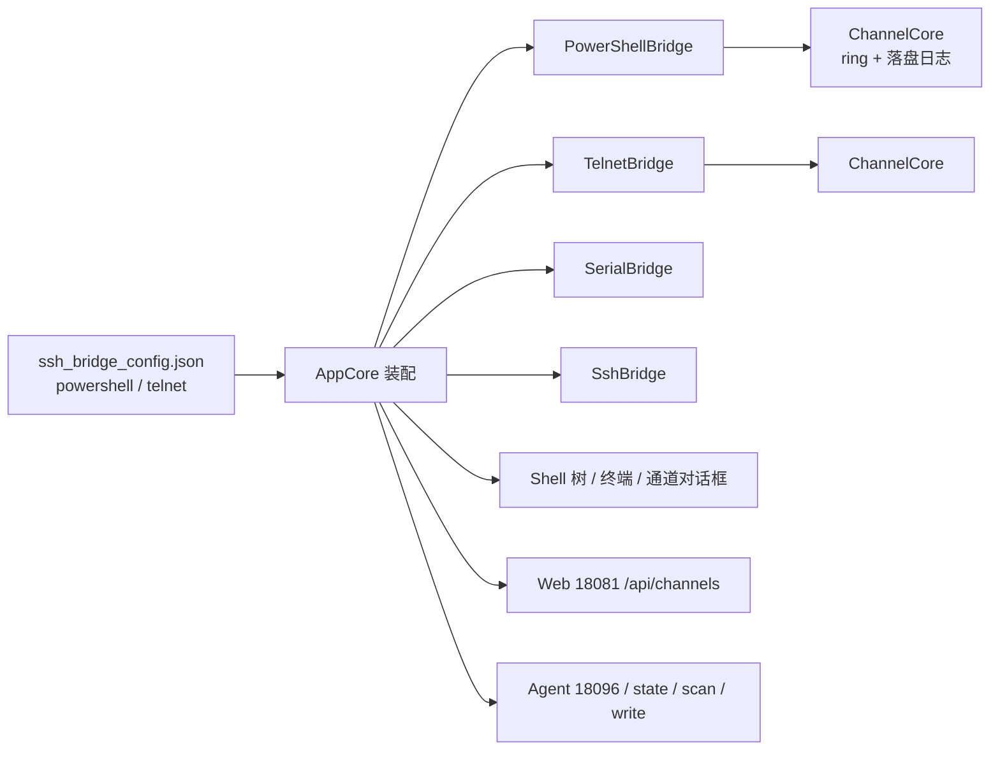

# 详细设计：PowerShell 与 Telnet 通道（Step 15）

分支：`feature/powershell-telnet-20261124`  
目标：让 PowerShell、Telnet 与串口、SSH 一样成为**正式通道类型**，不是只有树节点占位。

## 1. 目标与边界

对等范围：

| 能力 | 串口 | SSH | PowerShell（本次） | Telnet（本次） |
|---|---|---|---|---|
| 功能配置持久化 | 是 | 是 | 是 | 是 |
| 左侧通道树分组与计数 | 是 | 是 | 是 | 是 |
| 新建/编辑/删除对话框 | 是 | 是 | 是 | 是 |
| 终端下行/上行 | 是 | 是 | 是 | 是 |
| 连接状态/错误显示 | 是 | 是 | 是 | 是 |
| 断开/重连/右键菜单 | 是 | 是 | 是 | 是 |
| 自动启动与失败重试 | 是 | 是 | 是 | 是 |
| Web `/api/channels` CRUD | 是 | 是 | 是 | 是 |
| Agent `/state`、`/scan`、`/write`、`/log` | 是 | 是 | 是 | 是 |
| 分屏绑定/快捷指令/日志 | 是 | 是 | 是 | 是 |

边界：

- PowerShell 是**本机** `powershell.exe` / `pwsh.exe` 持久会话，不做 WinRM 远程 PowerShell。
- Telnet 是**原始 TCP** 客户端，内置最小 IAC 协商；不做 SSH 式加密，不实现完整 Telnet 选项族。
- 不改串口、SSH 的现有配置字段与行为；新字段只加到功能配置，UI 配置仍只存窗口/分屏状态。

## 2. 架构



约束沿用现有分层：`core` 不依赖 `ui/services`；两个新桥只实现 `IBridge`，由 `app` 装配。

## 3. 配置模型

功能配置文件新增两个顶层数组，与 `boards`、`ssh` 并列：

```json
{
  "powershell": [
    {
      "name": "ps-local",
      "enable": true,
      "shell": "powershell.exe",
      "args": "-NoLogo -NoProfile -ExecutionPolicy Bypass",
      "cwd": "",
      "line_ending": "cr",
      "buffer_size": 0,
      "log_enabled": true,
      "log_dir": "",
      "timestamp": false,
      "buttons": [],
      "quick_commands": []
    }
  ],
  "telnet": [
    {
      "name": "telnet-lab",
      "enable": true,
      "host": "127.0.0.1",
      "port": 2323,
      "connect_timeout_ms": 5000,
      "line_ending": "crlf",
      "width": 120,
      "height": 32,
      "buffer_size": 0,
      "log_enabled": true,
      "log_dir": "",
      "timestamp": false,
      "buttons": [],
      "quick_commands": []
    }
  ]
}
```

字段语义：

- `enable=false` 时加载阶段跳过，等价现有 SSH 的禁用语义。
- `buffer_size=0` 用 `default.buffer_size`；上限沿用 256 MiB。
- `timestamp` 默认 false：终端会话不插入时间戳。
- `cwd` 为空 = 启动器当前目录；PowerShell 子进程的当前目录。
- `shell` 可为绝对路径；命令行拼接时自动加引号，`args` 原样追加。
- `line_ending` 默认 PowerShell 为 `cr`（Enter 单字节），Telnet 为 `crlf`；`line_ending_for()` 统一返回。
- `host/port` 为 Telnet 目标；端口 1–65535，超时 500–60000 ms。
- 通道名在四类通道间全局唯一，改名同步 `ui.pane_channels`。

## 4. 数据面实现

### 4.1 PowerShellBridge

不依赖 ConPTY：使用**匿名管道 + 持久 PowerShell REPL**，避免伪终端句柄与宿主窗口模式差异。

子进程命令：

```text
"<shell>" <args> -EncodedCommand <UTF-16LE Base64>
```

编码后的脚本：

```powershell
[Console]::OutputEncoding = [Text.Encoding]::UTF8
$OutputEncoding = [Text.Encoding]::UTF8
while ($true) {
  [Console]::Out.Write("PS> "); [Console]::Out.Flush()
  $line = [Console]::In.ReadLine()
  if ($null -eq $line) { break }
  if ($line.Trim() -eq 'exit') { break }
  try {
    $r = Invoke-Expression $line 2>&1 | Out-String -Width 4096
    if ($r.Length -gt 0) { [Console]::Out.Write($r); [Console]::Out.Flush() }
  } catch {
    [Console]::Out.WriteLine("ERR: " + $_.Exception.Message)
  }
}
```

手柄：

- `stdin` 写端归桥；`stdout` 读端归 RX 线程；`stderr` 接 `NUL`，避免 PowerShell 的 CLIXML 污染终端。
- `CreateProcessW` 使用 `CREATE_NO_WINDOW | STARTF_USESTDHANDLES`，`bInheritHandles=TRUE`，只让 `in_r / out_w / NUL` 可继承。
- 桥内维护输入行缓冲：
  - 可打印 UTF-8 字节立即写入 ring 做本地回显；
  - Backspace/0x7F 删除最后一个 UTF-8 码点并回写 `\b \b`；
  - Enter（CR/LF）提交整行到 `CmdQueue`，追加 `\r\n`；
  - ESC 序列、Ctrl+C 暂不转发，避免污染行缓冲。
- `write()` 只在进程存活时接收字节；回显不增加 `tx_bytes`，提交给子进程才计入下行。
- RX 线程 `ReadFile(stdout)`，退出即 `io_alive_=false`；`running()` 要求进程存活且 RX 存活。
- 自动重试：`start()` 失败由 `AppCore` 退避重开；进程自行退出由 1 秒 watchdog 发现后重开，手动断开则抑制。
- `status_json` 输出 `pid/shell/state/peer/line_buffer/last_error/reconnects`。

### 4.2 TelnetBridge

- 非阻塞 connect + `select` 超时，循环检查 `stop_`，避免断开/退出时卡死。
- 连接成功后：
  - 发送最小协商：`IAC WILL SGA`、`IAC DO ECHO`、`IAC DO SGA`、`IAC WILL BINARY`、`IAC DO BINARY`；
  - 发送 NAWS 窗口尺寸（`IAC SB 31 <w> <w> <h> <h> IAC SE`）。
- RX 状态机：
  - `normal` 原样输出；
  - `iac` 处理 WILL/WONT/DO/DONT，接受 ECHO/SGA/BINARY/NAWS，拒绝其它；
  - `sb` 丢弃子协商内容，直到 `IAC SE`；
  - 输出不把 IAC 字节写入 ring。
- 断线后按 2/4/8/15 秒退避，`running()` 仅在 TCP 已连接时为真；`reconnect()` 唤醒 RX 立即重连。
- TX 线程从 `CmdQueue` 取数据写 socket；未连接时 `write()` 返回 0，避免堆积过期命令。
- `resize_terminal` 更新本地宽高并发送 NAWS；不依赖服务端。
- `status_json` 输出 `peer/port/state/last_error/reconnects/width/height`。

## 5. AppCore 装配

- `AppConfig` 增 `powershell`、`telnet` 数组；`Entry.kind` 扩为四值。
- `build_entries` / `reload_config` 顺序：串口 → SSH → PowerShell → Telnet；每类独立匹配、独立热应用。
- `start_auto`：PowerShell、Telnet 与 SSH 一样自动启动；PowerShell 失败进入 `want_open` 重试，Telnet 由桥内重试。
- `rebind_kicks_locked` 按 `kind` 分派 `set_kick`，不再假定“非串口即 SSH”。
- `upsert_*`、`delete_channel`、`has_channel`、`buttons_of`、`quick_commands_of` 覆盖四类；改名同步分屏绑定。
- `is_ssh_name` 保持只判 SSH；新增 `kind_of(name)` 供对话框/右键/Web 精确判断。
- `line_ending_for` 增加 PowerShell/Telnet；PowerShell 默认 `cr`。
- `state_json` 的 `last_error` 对所有桥通用；PowerShell 追加 `want_open/retry_attempt`。

## 6. UI / 编辑器

- `Shell::fill_tree` 已静态分组；本次只需让 Entry 真正存在，计数自动变化。
- `ChannelDialog` 的 `bool ssh` 改为 `ChannelKind`（serial/ssh/telnet/powershell）。
- 新建菜单、右键分组菜单增加“新建 Telnet 通道”“新建 PowerShell 通道”；具体通道菜单复用打开/重连/断开/编辑/删除，SFTP 仍只对 SSH 显示。
- 对话框新增：
  - 共用：名称、类型、日志；
  - Telnet：主机、端口、超时、列/行、行尾；
  - PowerShell：shell、args、工作目录、行尾。
- 编辑时类型锁定；保存走 `upsert_telnet/upsert_powershell`；删除仍走统一 `delete_channel`。
- 终端输入直接写桥；PowerShell 的本地回显由桥完成，Telnet 依赖服务端回显。

## 7. Web / Agent

- `/api/channels` GET 新增 `powershell`、`telnet` 两个数组；POST/delete 接受四种 `kind`。
- Web 通道页新增两个按钮与字段组；卡片按 kind 显示详情。
- Agent 的 `/state`、`/scan` 自动包含新 Entry；`features` 增 `telnet_link`、`powershell_link`；`/write`、`/command`、`/log` 通过统一 `IBridge` 生效，不新增专用协议。
- Agent 的 `serial_control` 只对串口为 true，避免把本地 shell 误当串口控制。

## 8. 影响面矩阵

| 圈层 | 项目 | 预期 | 验证 |
|---|---|---|---|
| 直接 | 配置模型/序列化 | 四类数组往返不丢、未知键保留 | 配置往返脚本 + step15 |
| 直接 | `AppCore` 装配/重载 | 新通道新增、改名、删除不误伤旧通道 | step15 + step1 |
| 直接 | 两个新桥 | 启停、收发、重连、状态 | step15 |
| 相邻 | 串口自愈 | 2/4/8/15 退避、手动断开抑制不变 | step14 19 项 |
| 相邻 | SSH/SFTP | SSH 热应用、SFTP 入口、入站 SSH 不变 | step3 + ui bridge + 手工 SFTP |
| 相邻 | 终端与分屏 | 四类通道可绑定、切画框、快捷指令 | step15 + 桌面审计 |
| 全局 | 配置拆分 | 新字段只进功能文件，UI 文件仍 280 B 结构 | 配置检查 + step14 |
| 全局 | Web/Agent | 18081 通道页/终端、18096 状态与写不回归 | Web 162 + Agent 检查 |
| 全局 | 生命周期 | 退出后无残留 powershell/telnet 线程/端口 | 退出脚本 + netstat |

## 9. 失败路径

- PowerShell shell 路径不存在：`start` 返回 false，记录 `CreateProcess failed`，AppCore 进入离线/重试；手动断开保持 idle。
- PowerShell 子进程被外部结束：RX 退出，`running=false`，看门狗重开。
- Telnet 端口未监听：连接超时，状态 offline，`last_error` 含 `connect ... failed`；服务启动后自动恢复。
- Telnet 服务端主动断开：RX 读到 0，状态 offline，按退避重连。
- 删除/改名四类同名冲突：保存前拒绝，不落盘。


## 10. 二次复核修正（2026-11-24）

- Telnet `reconnect()`：与 `stop()` 保持一致，先 `close_socket()` 再唤醒 RX；仅 `shutdown()` 在 Windows 上可能无法唤醒阻塞 `recv()`，会出现“已连接点重连但状态停在 offline”的假重连。
- Web 新建默认值：网页表单必须自己带正确缺省，不能依赖后端补值。PowerShell 行尾 `cr`，Telnet 行尾 `crlf`，串口/SSH 仍为 `none`。
- Agent 设备页类型列：按四类 `kind` 分支显示，不能只区分 SSH/串口，否则 PowerShell/Telnet 会被误标为串口。
- 验收由 53 项扩展到 74 项，新增 cwd/UTF-8、已连接重连、改名分屏绑定、Telnet 编辑、真实浏览器表单与重启持久化。
