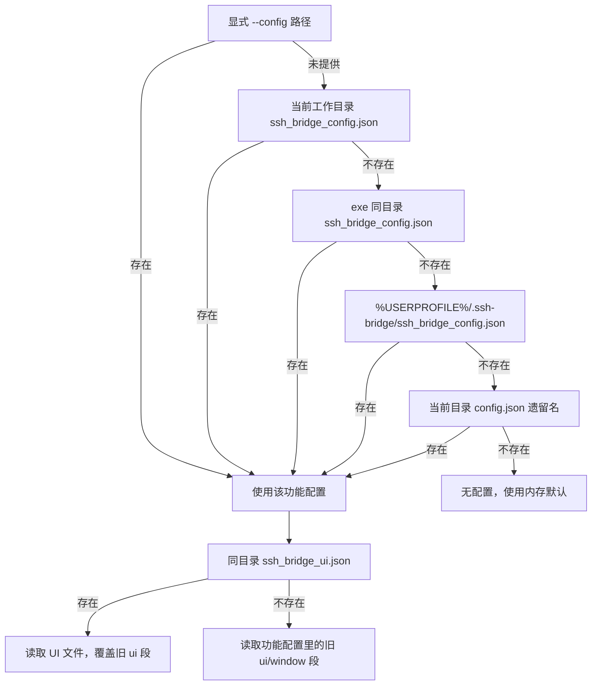
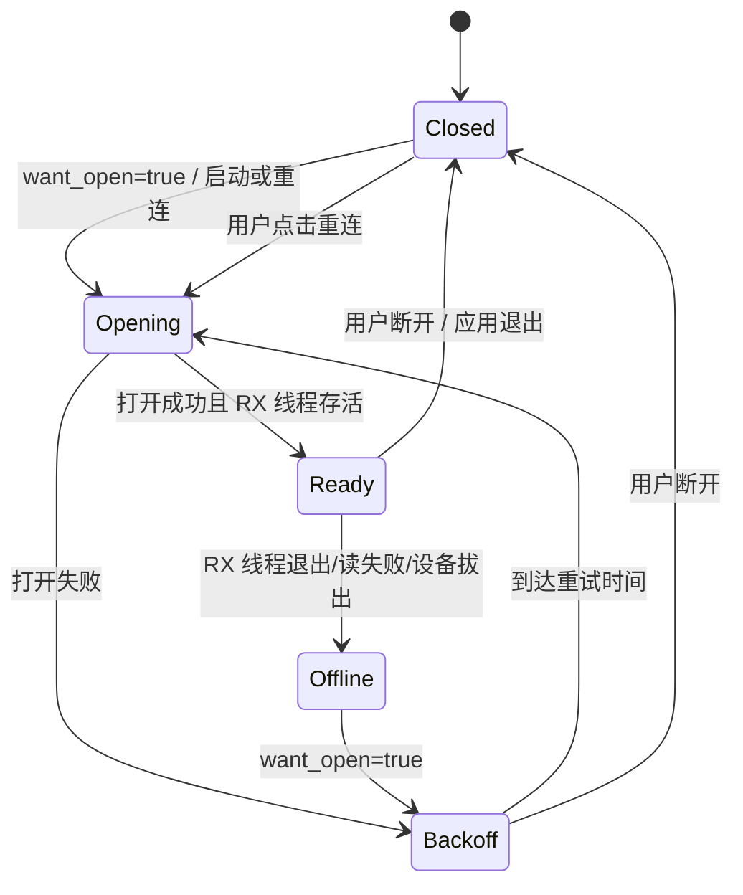

# 配置拆分、窗口状态与串口自愈详细设计

- 版本：v1.0
- 日期：2026-11-23
- 分支：`feature/config-selfheal-20261123`
- 适用范围：ssh-bridge v3 桌面端、Web 控制台、Agent UI 桥、串口桥

## 1. 问题与目标

本轮不是“改一个配置值让界面看起来正常”，而是消除四类会反复回归的结构性缺陷：

1. 功能配置与窗口配置混在同一个 `ssh_bridge_config.json`，窗口状态保存会重写功能配置，功能保存也可能覆盖窗口状态。
2. 配置查找依赖启动目录，双击 `output/build/ssh_bridge3.exe` 时找不到验收配置，回退到用户目录旧配置，导致 Web `18081`、Agent `18096` 关闭，串口 `auto_open=false`。
3. 串口只在启动时打开一次；接收线程异常退出后 `running_` 仍可能为真，也没有后台重试，必须人工点“重连”。
4. 通道树没有右键菜单，用户只能绕到顶部菜单或底部按钮操作通道。

目标：

- 功能配置与窗口配置物理分文件，任一文件保存都不触碰另一文件。
- 查找顺序固定为“显式路径 → 当前目录 → exe 同目录 → 用户目录兜底 → 遗留文件名”。
- 旧单文件配置可无损读取，首次保存时自动拆分，不因迁移丢失字段。
- 手工断开与故障掉线分离：手工断开不自动重连，故障掉线按退避自动重连。
- 通道树右键具备完整配置菜单，且与顶部菜单走同一套命令处理。
- 每个阶段都有影响面矩阵和相邻功能回归，修复完成后跑全量桌面/Web/配置回归。

## 2. 配置模型

### 2.1 文件职责

| 文件 | 职责 | 不包含 |
| --- | --- | --- |
| `ssh_bridge_config.json` | 通道、SSH、Web、Agent、TFTP、NFS、共享目录、TCP 转发、隧道、发现、继电器、入站 SSH | `ui`、`window` |
| `ssh_bridge_ui.json` | 窗口矩形、最大/最小化提示、状态栏显示、托盘行为、字体、回滚行数、分屏布局、画布通道、活动画框 | 通道、服务、端口、设备 |
| `output/ui_prefs.ini` | 仅作为旧窗口矩形的一次性迁移来源 | 新数据不再写入 |

### 2.2 功能配置结构（节选）

```json
{
  "boards": [
    { "name": "ok3568", "serial_device": "COM5", "baudrate": 115200, "auto_open": true }
  ],
  "ssh": [],
  "web": { "enable": true, "port": 18081, "token": "" },
  "agent": { "enable": true, "port": 18096, "token": "" },
  "tftp": { "enable": false, "port": 69, "root": "work/share" },
  "nfs": { "enable": false, "port": 2049 }
}
```

### 2.3 窗口配置结构

```json
{
  "schema": "ssh-bridge-ui/1",
  "ui": {
    "close_to_tray": true,
    "start_minimized": false,
    "scrollback_lines": 5000,
    "font_size": 15,
    "split": 1,
    "active_pane": 0,
    "pane_channels": ["ok3568"],
    "show_statusbar": true
  },
  "window": {
    "rect": "120,80,1300,820"
  }
}
```

约束：

- `ui` 段保持旧字段名，Web/Agent 导出兼容。
- 新增 `show_statusbar` 只控制状态栏可见性，不改变窗口几何恢复和分屏布局。
- `window.rect` 使用屏幕坐标 `left,top,right,bottom`，尺寸小于 400×300 时忽略并回退默认。
- 没有窗口矩形时，才读取旧 `output/ui_prefs.ini`；迁移后不再写该文件。

## 3. 配置查找与迁移

### 3.1 查找顺序



说明：

- “当前目录优先”满足测试、多实例和绿色版就地配置。
- exe 同目录是安装版的“本目录”；用户目录仅兜底，不再因为启动位置不同而悄悄换配置。
- UI 文件永远与选中的功能配置同目录，避免功能配置在 D 盘、窗口状态写到 C 盘用户目录。

### 3.2 加载规则

1. 先完整读取功能配置，解析所有功能字段；旧文件里的 `ui/window` 暂存为兼容值。
2. 若同目录 `ssh_bridge_ui.json` 存在，解析 `ui` 与 `window` 并覆盖兼容值。
3. 若 UI 文件不存在，保留旧文件里的 `ui/window`。
4. 加载阶段绝不写盘，保证“启动不重写配置”闸门仍成立。

### 3.3 保存规则

| 操作 | 写入文件 | 不写文件 |
| --- | --- | --- |
| 通道/服务/端口/继电器变更 | 功能配置 | UI 文件 |
| 分屏、活动画框、字体、状态栏、窗口矩形 | UI 文件 | 功能配置 |
| Web 配置页整包保存 | 两份都写，但字段各自归类 | 另一文件的无关字段 |
| 首次保存旧统一配置 | 功能文件删除 `ui/window`；UI 文件生成 | 旧文件其它未知键保留 |

实现要求：

- 功能保存先从磁盘读回对象，保留未知键；写入前删除 `ui`、`window` 顶层键。
- UI 保存只构造 `schema/ui/window`，不读取、不重写功能文件。
- 两文件都使用“临时文件 + 原子替换”，避免半截 JSON。

## 4. 串口生命周期与自动重连

### 4.1 状态机



关键语义：

- `want_open` 表示“用户/配置希望这个串口在线”，不等于当前已打开。
- `auto_open=true` 的板卡启动即置 `want_open=true`；打开失败也保持，进入退避重试。
- 用户点击“断开”置 `want_open=false`，后续 watchdog 不得把端口重新打开。
- 用户点击“重连”置 `want_open=true` 并立即尝试。
- RX 线程无论正常退出还是异常读失败，都必须把“接收存活”置 false，使 UI 与 watchdog 能观察到离线。

### 4.2 退避策略

| 连续失败次数 | 下次重试间隔 |
| --- | --- |
| 1 | 2 秒 |
| 2 | 4 秒 |
| 3 | 8 秒 |
| 4 及以上 | 15 秒（上限） |

- 打开成功后失败计数归零。
- watchdog 在 UI 定时器中运行，周期 1 秒，不在 RX 线程里直接重开，避免线程自 join。
- 重试失败只更新状态与错误，不弹模态框，不阻塞 UI。
- 端口被其它进程占用时保持“离线（打开失败：Access denied）”，释放后自动恢复。

### 4.3 影响面

- SSH 通道已有自己的后台重试，不纳入串口 watchdog。
- `loop:` 虚拟串口同样适用，便于自动化验证失败后恢复。
- 手动断开、应用退出、配置重载都必须清理 `want_open`，否则会出现“退出了还在重连”的假象。
- 重载后 `want_open` 以新配置的 `auto_open` 为准，不沿用旧运行态；用户需要守护时点“重连”重新置 true。

### 4.4 实现落点

- `SerialBridge` 增加 `io_alive_`；`running()` 返回 `running_ && io_alive_`。RX、loop RX、writer 三个线程入口都挂 `IoAliveGuard`，任何退出路径都会把 `io_alive_` 置 false。
- RX 的 overlapped 失败不再 `continue`，直接退出线程并记录错误；写线程遇到非 pending 的写失败同样退出。
- `AppCore::Entry` 增加 `want_open / retry_at_ms / retry_attempt`；`start_entry` 失败即排期，`poll_serial_retry` 由 UI 1 秒定时器驱动。
- `WM_TIMER` 先调用 `poll_serial_retry()`，再判断窗口是否可见；隐藏到托盘时仍守护串口，但不刷新 UI。

## 5. 通道树右键菜单

菜单按节点类型生成：

| 节点 | 菜单项 |
| --- | --- |
| 具体通道 | 打开/重连、断开、编辑通道、删除通道、SFTP、新建串口、新建 SSH、重新加载配置 |
| 分组节点（SSH/串口/Telnet/PowerShell） | 新建串口、新建 SSH、重新加载配置 |

交互约束：

- 右键先选中命中节点，再弹出菜单，避免“右键 A、操作 B”。
- 菜单命令复用 `WM_COMMAND` 的既有 ID 与处理函数，不复制业务逻辑。
- 菜单打开期间不触发通道切换以外的副作用。
- 菜单项状态：当前通道离线时“断开”置灰；在线时“重连”仍可用（强制重开）。

## 6. 影响面矩阵（强制回归）

| 变更点 | 直接影响 | 相邻影响 | 必跑回归 |
| --- | --- | --- | --- |
| 配置路径/解析/保存 | 启动通道数、端口、Web/Agent | Web 配置页、Agent `/state`、分屏恢复、窗口矩形 | step1、step3、step6、Web 162、配置专项 |
| UI 文件拆分 | 分屏/状态栏/窗口几何 | 托盘启动、窄窗收起、布局保存 | step3、UI 桌面审计、窗口几何专项 |
| 串口自愈 | 串口在线状态、重连按钮 | 状态栏汇总、板控按钮、Web 通道页、Agent 通道动作 | step1、step5、step6、串口专项、Web 通道页 |
| 右键菜单 | 通道切换/编辑/删除 | 顶部菜单、SFTP、配置重载、快捷键 | step6、step7、桌面审计菜单阶段 |
| Agent 端口 | 18096 桥 | Web Agent 页、桌面审计 `/state` | Agent 探活、step7、Web Agent 页 |
| Web 启用 | 18081 控制台 | 所有 Web 页面、token 鉴权 | Web 12 页 + 162 项 |

## 7. 验收闸门

### 7.1 每阶段闸门

1. 写清测试清单与失败复现步骤。
2. 编译 0 error、0 warning。
3. 新增专项测试全绿。
4. 相邻功能回归全绿。
5. `scripts/quality_gate.ps1` PASS。
6. 一次提交只含一个最小功能单元；结构重构单独提交并附影响面。

### 7.2 最终闸门

- 配置专项：本地优先、系统兜底、旧配置迁移、双文件互不覆盖、未知键保留。
- 窗口专项：矩形恢复、状态栏开关、分屏/活动画框不丢。
- 串口专项：初始打开失败 → 自动重试 → 释放端口 → 自动恢复；手工断开不重连。
- 菜单专项：右键弹窗、菜单项完整、重连/编辑/删除/新建可用。
- 服务专项：`18081` Web 可打开，`18096` `/state` 可用，`2222` 入站不冲突。
- 全量：桌面临时审计、Web 162 项、19 套件/既有 step 套件不回退。
- 交付：报告列出逐项 PASS、截图路径、日志路径、回滚方式。

## 8. 回滚

- 代码回滚：`git revert` 本轮各阶段提交，或切回 `feature/web-console-complete-20261123`。
- 配置回滚：修复前备份 `ssh_bridge_config.json.bak-20261123`；UI 文件删除即回退到旧 `ui` 段/`ui_prefs.ini`。
- 运行回滚：停止 `ssh_bridge3.exe`，用旧 exe 和备份配置启动；端口 `18081/18096` 会按旧配置关闭。

## 9. 非目标

- 不改变 Web 控制台的鉴权模型和页面布局。
- 不把 NFS/TFTP 做成新的后台服务，仅归类与持久化。
- 不在本轮重写终端渲染/输入协议。
- 不引入外部配置库；继续使用内置 cJSON 与 Win32。
